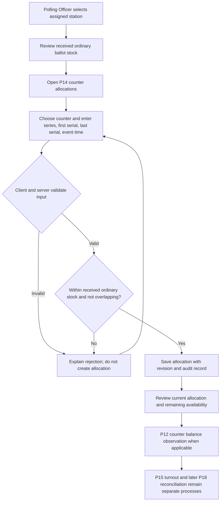

# P(14) — Control Sheet for Ballot-Paper Flow to Issuing Counters

**Project:** Election Desk — Election Management and Voting System  
**Scope:** Issuance-counter allocations of ordinary paper ballots at an assigned polling station  
**Status:** Supporting workflow documentation for review; not a new implementation or proof of acceptance testing

## 1. Purpose and boundary

P(14) records which numbered ordinary ballot-paper stock was transferred to each issuing counter, **when** it was allocated, and which previously received stock supports that transfer. It supplies an auditable link between received stock, counter allocations, later counter balance observations and paper-ballot accounting.

This application is a **staff management tool for physical paper elections**. It does not cast electronic votes or replace external voter identity checks. The project's Polling Officer role performs the allocation, within its assigned station and election scope.

The supplied operational P(14) reference illustrates a comparable procedure in MISES. It is a *reference system*, not a complete specification of Election Desk. In particular, its fixed bundle sizes, auto-filled end serial and 15-minute-past-the-hour submission procedure **must not be represented as implemented Election Desk features** without a separate requirement and design review.

## 2. End-to-end workflow

> The arrows show operational dependencies, not a claim that P(14) itself automatically submits P(12), P(15), or P(18).

## 3. Recorded information

| Field | Meaning | Source/validation |
| --- | --- | --- |
| Station and election context | Which station owns the work | Logged-in account and active workspace scope |
| Counter | Issuing counter receiving the batch | Must exist at the selected station |
| Series | Printed ballot series | Non-blank; maximum 64 characters |
| Serial from / to | Inclusive beginning and ending serial numbers | Each contains 1–18 ASCII decimal digits; end not before start |
| Quantity | Number of paper ballots allocated | Computed as `int(serial_to) - int(serial_from) + 1` |
| Event time | When the paper allocation occurred | Timezone-aware input; distinct from server entry time |
| Request ID | Distinguishes/reconciles one save operation | UUID used to detect safe retries/conflicting duplicates |
| Revision and correction reason | History of an amended allocation | Expected revision and nonblank reason required for correction |

Printed serial strings are retained, including possible leading zeros, while quantity calculations use integers.

## 4. Rules and invariants

1. Only an authorized Polling Officer may modify the assigned station's P(14) allocations.
2. The selected counter must belong to that station.
3. The allocated serial range must be within **received ordinary** stock for the same series; replacement and tendered reserves are kept separate.
4. Allocations must not double-allocate stock; overlap and return timing are checked against current stock ownership.
5. Inclusive quantity must be positive. Example: `00401–00500` means **100** papers, not 99.
6. A correction must reference the current revision and supply an explanation. The earlier revision and audit trail are preserved.
7. A duplicated request with identical details can be recognized; the same request identifier with changed details must be rejected.
8. An uncertain save outcome must be checked before the operator tries to enter the paper record again.

## 5. Worked demonstration example

The fictional demo supplies **500 ordinary** ballots plus **10 replacement** and **10 tendered** reserve ballots, for **520 received** in total. Each of two counters receives **200 ordinary** papers. An observation finds **50 remaining per counter**, resulting in `400 allocated − 100 remaining = 300 ordinary papers issued`. A further 100 ordinary papers remain centrally. These values are **seeded demonstration data**, not independently measured real-election results.

## 6. Proposed acceptance checks

A reviewable P(14) change should show: a valid allocation is saved and listed; invalid/overlapping serial ranges are rejected; a counter outside the station cannot be used; the quantity is correct; an authorized correction preserves earlier revisions; and a retry does not create a second allocation. See [P14_TEST_SCENARIOS.md](P14_TEST_SCENARIOS.md).

## 7. Implementation traceability (source-code review)

| Concern | Current project file |
| --- | --- |
| Allocation API, model validation, correction, idempotency and audit | `src/election/server/allocations.py` |
| Serial number and received range validation | `src/election/server/stock_serials.py` |
| Received-stock coverage and current available stock | `src/election/server/stock_inventory.py` |
| Desktop controller, quantity preview and uncertain-save handling | `src/election/desktop/allocations.py` |
| Editable allocation form | `src/election/desktop/qml/AllocationPage.qml` |
| Prepared fictional stock and turnout | `demo/scenario.json`, `demo/README.md` |

**Review boundary:** This document describes behavior visible in the examined code snapshot. Changes to rules, bundle sizes, or reporting cadence should go through the team's normal review process rather than be copied mechanically from the external operational reference.
