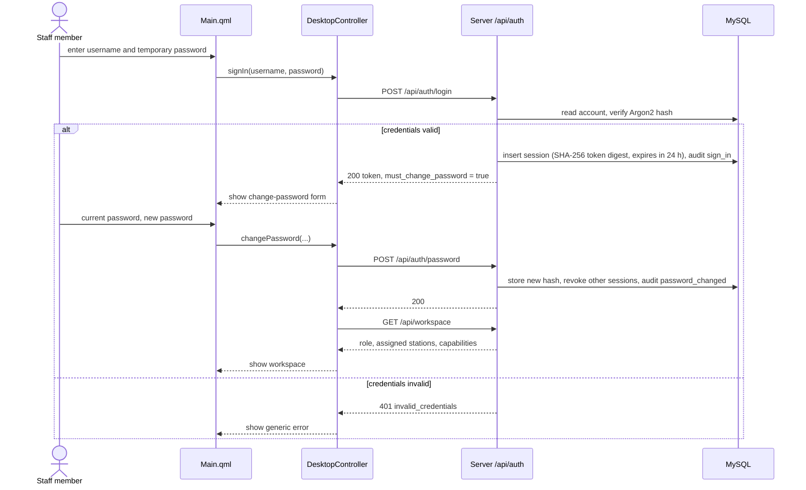

# 01. Sign-in, first login, staff accounts and basic layout

| Item | Value |
| --- | --- |
| Person in charge | Rico |
| Reference manual | Introduction, first-time login and basic interface (pp. 26–35) |
| Server code | `src/election/server/app.py`, `security.py`, `staff.py`, `station_access.py` |
| Desktop code | `src/election/desktop/controller.py`, `staff.py`, `qml/Main.qml`, `qml/StaffPage.qml` |
| API | `/api/auth/login`, `/api/auth/me`, `/api/auth/password`, `/api/auth/session`, `/api/workspace`, `/api/accounts`, `/api/health` |
| Former automated tests | `tests/test_auth_api.py`, `tests/test_staff_api.py`, `tests/test_staff_desktop.py` (commit `c68fb54`) |

## 1. User requirements

- UR-01.1 Staff sign in with a personal account before they can see any election record.
- UR-01.2 A new member of staff must replace the temporary password on first sign-in.
- UR-01.3 The administrator creates staff accounts, gives each one a role and assigns stations.
- UR-01.4 After sign-in the user sees only the functions of their role and can change language
  and sign out from any page.

## 2. Functional requirements

| ID | Requirement | Role | Implemented in |
| --- | --- | --- | --- |
| FR-AUTH-01 | The system shall authenticate a user by username and password and issue a session token. | All | `POST /api/auth/login` |
| FR-AUTH-02 | The system shall return the same error for a wrong password and for an unknown username. | All | `invalid_credentials` in `app.py` |
| FR-AUTH-03 | The system shall force a user who signs in with a temporary password to change it before any workspace function is available. | All | 403 `password_change_required`; `GET /api/workspace` |
| FR-AUTH-04 | The system shall accept a new password only if it has 12 to 128 characters, differs from the current password, and the current password is supplied correctly. | All | `POST /api/auth/password` |
| FR-AUTH-05 | The system shall revoke all other sessions of the account when its password changes. | All | `app.py` |
| FR-AUTH-06 | The system shall end a session on sign-out and 24 hours after sign-in. There shall be no inactivity time-out. | All | `DELETE /api/auth/session`; session expiry |
| FR-AUTH-07 | The system shall let the administrator create a staff account with display name, role, enabled flag and assigned stations, and set a temporary password. | Administrator | `POST /api/accounts`, `PUT /api/accounts/{id}`, `POST /api/accounts/{id}/password-reset` |
| FR-AUTH-08 | The system shall refuse sign-in for a disabled account and shall revoke existing sessions when a role or station assignment changes. | Administrator | `staff.py` |
| FR-AUTH-09 | The system shall always keep at least one enabled administrator. | Administrator | `staff.py` (last administrator check) |
| FR-AUTH-10 | The system shall show each user only the stations assigned to them and the navigation items permitted for their role. | All | `GET /api/workspace/stations`; `Main.qml` |
| FR-AUTH-11 | The system shall let the user switch the interface language between Traditional Chinese, Simplified Chinese and English at any time. | All | `DesktopController.setLocale` |
| FR-AUTH-12 | The system shall let the administrator read the audit history of an account without exposing passwords, hashes or tokens. | Administrator | `GET /api/accounts/{id}/audit` |

Non-functional requirements that apply: NFR-SEC-01 to NFR-SEC-04, NFR-USA-01 (see `00-overview.md`).

## 3. Use case UC-01: First sign-in

| Field | Description |
| --- | --- |
| Actors | Staff member (any role); Administrator (secondary) |
| Description | A staff member signs in for the first time with a temporary password issued by the administrator and must set a personal password before working. |
| Data | Username, temporary password, new password (12–128 characters) |
| Stimulus | The staff member presses "Sign in" |
| Response | The workspace opens with the stations and functions of the user's role |
| Pre-condition | The account exists and is enabled; the client can reach the server over HTTPS |
| Post-condition | The temporary password no longer works; older sessions are revoked; audit events `sign_in` and `password_changed` exist |
| Comments | A wrong password and an unknown username give the same message |

Main flow:

1. The user enters username and temporary password.
2. The system verifies the credentials and creates a session.
3. The system shows "First sign-in: change your temporary password to continue."
4. The user enters the current password and a new password twice.
5. The system saves the new password, revokes other sessions and opens the workspace.

Alternative flows:

- 2a. Credentials are wrong: the system shows one generic error; no session is created.
- 4a. The new password is shorter than 12 characters or equal to the current one: the system
  rejects it and the old password remains valid.
- 5a. The account is disabled while signed in: the next request returns `session_expired`.

## 4. Sequence diagram

## 5. Design notes

- Layout (`Main.qml`): a side navigation list titled "Workspace" with one button per function.
  The set-up items (Election setup, Station setup, Election schedule, Complaint categories,
  Invalid ballot reasons, Server backups, Staff accounts) are shown only to an administrator.
  The window also carries a language selector, the signed-in user and role, and "Sign out".
- The administrator has no station assignment and no operational override.
- Since v1.1.0 the navigation depends on the voting method of the active election. In an
  e-polling election the paper-only pages are hidden, a Supervisor has the extra page "Live
  e-polling results", and while a voting session is open the window is in voter mode: the
  navigation and "Sign out" are replaced by the voting screen, while the language menu stays
  available (document 14).
  The requirements and test cases of this document were written on the physical-ballot demo.
- Error codes: 401 `invalid_credentials`, 401 `session_expired`, 403 `password_change_required`,
  403 `administrator_required`.

## 6. Test cases

System tests (manual, on a rehearsal copy of the paper-ballot demo server):

| ID | Requirement | Pre-condition | Steps | Expected result | Result |
| --- | --- | --- | --- | --- | --- |
| TC-AUTH-01 | FR-AUTH-01, FR-AUTH-10 | Demo running; account `demo_polling` | 1. Start the client. 2. Sign in as `demo_polling`. | Workspace opens; only "Harbour Community Hall" is listed; no "Election setup" items | **PASS** — The Polling Officer workspace opened at Harbour Community Hall and the sidebar omitted Election Setup. [Screenshot](evidence/rico/TC-AUTH-01.png) |
| TC-AUTH-02 | FR-AUTH-02 | Demo running | 1. Sign in as `demo_polling` with a wrong password. 2. Sign in as `nobody` with any password. | The same error message both times; no workspace | **PASS** — Both attempts stayed on the sign-in page and showed the same error. The second username was absent from the staff account list shown. [Wrong password](evidence/rico/TC-AUTH-02-01.png), [Unknown username](evidence/rico/TC-AUTH-02-02.png), [Staff account list](evidence/rico/TC-AUTH-02-03.png) |
| TC-AUTH-03 | FR-AUTH-07, FR-AUTH-03 | Signed in as `demo_admin` | 1. Open "Staff accounts". 2. Create `test_officer`, role Polling Officer, station Harbour Community Hall, temporary password of 12 characters. 3. Sign out. 4. Sign in as `test_officer`. | The change-password form appears and no other page can be opened | **PASS** — The new Polling Officer was assigned to Harbour Community Hall and prompted to change the temporary password before the workspace appeared. [Account setup](evidence/rico/TC-AUTH-03-01.png), [First sign-in](evidence/rico/TC-AUTH-03-02.png) |
| TC-AUTH-04 | FR-AUTH-04 | Continue from TC-AUTH-03 | Enter a new password of 11 characters, then the same as the temporary password, then a valid 12-character password. | First two are rejected; third is accepted and the workspace opens | **PASS** — An 11-character password and reuse of the temporary password were rejected. A valid 12-character password was saved and the workspace opened. [Length validation](evidence/rico/TC-AUTH-04-01.png), [Reuse validation](evidence/rico/TC-AUTH-04-02.png), [Successful change](evidence/rico/TC-AUTH-04-03.png) |
| TC-AUTH-05 | FR-AUTH-11 | Signed in | Switch language to English, 繁體中文, 简体中文. | All labels change without restart | **PASS (tester-reported)** — English, Traditional Chinese, and Simplified Chinese labels updated immediately without restarting the client. |

Equivalence partitions for the password length (Lecture 8): fewer than 12 (invalid; test 11),
12 to 128 (valid; test 12 and 128), more than 128 (invalid; test 129).

Automated tests (unit / API level, from the project history):

| Test | Requirement |
| --- | --- |
| `test_auth_api.py::test_wrong_password_and_unknown_account_have_the_same_public_error` | FR-AUTH-02 |
| `test_auth_api.py::test_first_password_change_unlocks_workspace_and_revokes_earlier_sessions` | FR-AUTH-03, FR-AUTH-05 |
| `test_auth_api.py::test_session_has_no_idle_timeout_but_expires_at_exactly_24_hours` | FR-AUTH-06, NFR-SEC-03 |
| `test_auth_api.py::test_logout_revokes_the_session_on_the_server` | FR-AUTH-06 |
| `test_staff_api.py::test_disabled_staff_cannot_sign_in` | FR-AUTH-08 |
| `test_staff_api.py::test_last_enabled_administrator_survives_disable_demotion_and_concurrent_self_disables` | FR-AUTH-09 |
| `test_staff_api.py::test_administrator_reads_staff_audit_without_passwords_hashes_or_session_secrets` | FR-AUTH-12, NFR-SEC-02 |

## 7. Differences from the reference manual

| Manual | Election Desk | Reason |
| --- | --- | --- |
| Device log-in through MDM, then application log-in | One application sign-in | No managed tablets |
| Password of 8 or more characters with character classes | 12 to 128 characters | Simpler and stronger rule |
| First user confirms four station settings | Administrator configures station and issuing desks before polling day | Set-up is separated from operation |
| Home, Settings, Refresh, Sign-off icons | Side navigation list, language selector, "Sign out" | Desktop layout |

Rico’s manual run used Election Desk v1.1.0. TC-AUTH-02 screenshots show the shared demo endpoint. The environment for TC-AUTH-03 and TC-AUTH-04 could not be confirmed from the supplied screenshots. TC-AUTH-05 was reported by the tester without screenshot evidence.
