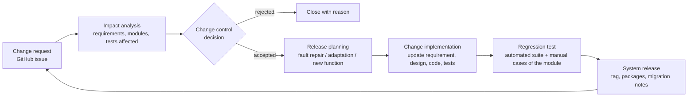

# 13. Software evolution plan

Election Desk v1.0.0 was tagged on 17 November 2026 and v1.1.0 on 21 November 2026. This
document describes how the system has changed and is expected to change after release, how changes are controlled, what is known to be
unfinished, and how the system and its data will eventually be retired (Lecture 9).

## 1. Why this system will evolve

| Driver | Example for Election Desk |
| --- | --- |
| New requirements appear when the system is used | Officers ask for the nine post-poll time fields of the manual on one page (document 07) |
| The business environment changes | Electoral rules change the invalid-ballot reasons or the reporting interval |
| Errors must be repaired | A statement shows a wrong total |
| New equipment is added | The client must run on tablets, as the reference system does |
| Performance or reliability must improve | A territory-wide election with hundreds of stations instead of the demo's one |

An election system has an unusual usage pattern: it is used intensively for a few days and
then not at all for months or years. Each election is in effect a new release cycle, so the
period between elections is the time for change, and the weeks before polling day require a
freeze.

The first evolution step has already happened. Release v1.1.0 added in-person electronic
voting (document 14) four days after v1.0.0. It is used in section 4.1 as a worked example of
the change process.

## 2. Life-cycle stage

| Stage (Lecture 9) | Meaning | Election Desk |
| --- | --- | --- |
| Evolution | The system is in operational use and new requirements are implemented | Now, after v1.0.0: release v1.1.0 (e-polling) was the first functionality addition; the change requests of section 5 are the next ones |
| Servicing | Only bug fixes and environmental changes; no new functionality | From the freeze before an election until its results are final; and later, when the team no longer adds features |
| Phase-out | Still in use, no further changes | When a replacement has been chosen; the system only keeps old elections readable |
| Retirement | Taken out of use | Section 8 |

## 3. Types of maintenance expected

| Type (Lecture 9) | Expected changes |
| --- | --- |
| Fault repairs | Defects found by the manual test cases (document 12, defect log); coding errors are cheapest, requirements errors (a rule misunderstood from the manual) are the most expensive |
| Environmental adaptation | New versions of Python (3.14 is pinned in `.python-version`), PySide6 / Qt, MySQL (8.4 is pinned by image digest in `compose.yaml`), FastAPI, Windows and macOS; expiry of the TLS certificate authority |
| Functionality addition and modification | E-polling in v1.1.0 (section 4.1); section 5, change requests CR-06 onwards |

Factors that will make maintenance of this system cost more than its development, and what
reduces them:

| Factor | Situation | Mitigation |
| --- | --- | --- |
| Team stability | A course team that dissolves after the term; one person made every commit | Documents 00 to 14; walkthroughs so that each module has a second person who can explain it |
| Program understanding | About 31,000 lines of server Python in 121 files, 28,500 lines of desktop Python in 66 files and 18,200 lines of QML in 40 files (v1.1.0); part of the code was produced with an AI coding agent (`AGENTS.md`) | Module documents link requirement → route → file; glossary; consistent naming of routes and error codes |
| Program age and structure | New, but already large; several files exceed 1,000 lines | Refactoring, section 6 |
| Regression test data | Removed from the release | CR-02 |

## 4. Change management process

Every change, including an urgent one, follows the same steps.

| Step | Rule |
| --- | --- |
| Change request | A GitHub issue with: who asks, what is wrong or wanted, which requirement ID it concerns, urgency |
| Impact analysis | Use document 11 to find the routes, files and test cases linked to the requirement; estimate effort |
| Change control | Group 61 lead, repository owner (Dennis), and module owner review and decide. They accept, defer or reject |
| Implementation | Change the requirement first, then the design, then the code and the tests. A database change is a new Alembic migration, never an edit of an old one |
| Regression test | Automated suite must pass; the manual cases of the changed module are re-run and recorded |
| Release | Semantic version: 1.0.x fault repair, 1.x.0 new function, 2.0.0 incompatible change of data or API. Git tag, GitHub release with Windows and macOS packages (`build-desktop.yml`) |
| Urgent change | During polling or counting only a fault repair that blocks operation is allowed. It may be coded first, but the requirement, the documents and the tests must be brought up to date immediately after the election (emergency repair process), otherwise documentation and code drift apart |
| Freeze | No release in the 7 days before polling day, except an urgent fault repair |

### 4.1 Worked example: e-polling in release v1.1.0

Release v1.1.0 is a functionality addition. The table compares what the repository shows with
the process above. It is written from the Git history, not from a record of the group's
decisions.

| Step | What the repository shows for v1.1.0 | Compared with the process |
| --- | --- | --- |
| Change request | No GitHub issue or pull request. The need follows from the topic title, "Election Management and Voting System": v1.0.0 managed an election but had no voting function | Agreed by Group 61 on 18 Nov 2026 after v1.0.0 to fulfill the "Voting System" requirement of Topic 2 |
| Impact analysis | 59 files changed (2,495 lines added, 348 removed). New: two tables, one API router, three client modules, two pages. Changed: election set-up, activation rule, polling workspace, navigation, demo importer | Document 11 did not exist yet; the impact can now be read from document 14, section 3 |
| Implementation | One commit, `f5105cb`. Schema change as a new migration, `0036_electronic_voting`, which keeps existing elections as physical-ballot elections (compatible change) | Follows the migration rule. Requirements and design were written afterwards (document 14) |
| Regression test | No automated tests exist (CR-02). Paper-only write routes were given a new check (`paper_election_required`), so paper-ballot functions were touched | Not met. The manual cases of documents 01 to 10 must be re-run on v1.1.0 (CR-05) |
| Release | Tag `v1.1.0`, version in `pyproject.toml`, GitHub release with Windows x64, macOS arm64 and macOS x86_64 packages | Follows the version rule (1.x.0 = new function) |

Lessons for the next change: raise the issue first, write the requirement and its test cases
before the code, and do not release without a regression run.

## 5. Known gaps recorded as change requests

These are facts about release v1.1.0 that a reader of the repository can verify. They are
listed here so that the report describes the system honestly and shows the next steps.

| No. | Type | Change request | Evidence | Priority | Owner |
| --- | --- | --- | --- | --- | --- |
| CR-01 | Documentation | Publish the project documents. `AGENTS.md` refers to `../ignore-docs/SPECIFICATION.md`, `../ignore-docs/adr`, `../ignore-docs/BUILDING.md` and other guides, but `docs/` is ignored by Git, so none of them is in the repository. This documentation pack can be committed as `docs/` after the line `/docs/` is removed from `.gitignore` | `AGENTS.md`; `.gitignore` line 9 | High, before submission | Dennis |
| CR-02 | Fault prevention | Restore the automated tests removed in commit `6b0b4a5` together with `src/election/dev.py`, re-add the test dependencies and bring failing tests up to date with v1.1.0 | Document 12, section 3 | High | Dennis |
| CR-03 | Process | Run tests, `ruff` and `mypy` in GitHub Actions on every push; today the only workflow builds the desktop packages | `.github/workflows/build-desktop.yml` | Medium | Dennis |
| CR-04 | Configuration management | All 830 commits are by one account. Each member should commit their own module document, test evidence and any fix from their own account, through a pull request reviewed by one other member | `git shortlog -sn` | High, before submission | All |
| CR-05 | Verification | Execute the 100 manual test cases on v1.1.0 and record the results | Document 12, section 6 | High, before submission | All |
| CR-06 | Functionality | Add the missing post-poll times of the manual as milestones, or document why box records replace them | Document 07, section 3 | Low | Lam |
| CR-07 | Functionality | Decide whether the Administrator should be able to see results read-only | Document 10 | Low | Future maintainers |
| CR-08 | Non-functional | Measure NFR-PERF-01 and NFR-USA-03; run a load test with more than one station | Document 12, section 5 | Medium | Dennis |
| CR-09 | Functionality | Import of stations and candidates from a file for a large election | No file-import route among the API routes of v1.1.0 | Low | Future maintainers |
| CR-10 | Functionality | District Committees Constituency forms DCC0 to DCC5 and the interface to a central results centre | Out of scope in v1.1.0 (document 00) | Low | Future maintainers |
| CR-11 | Environmental adaptation | Tablet-sized layout and touch input | Manual assumes tablets; v1.1.0 targets Windows and macOS desktops | Low | Future maintainers |
| CR-12 | Security | Independent security review before any real use: TLS set-up, password policy, backup encryption, audit log protection | Document 12, section 7 | High before real use | Future maintainers |
| CR-13 | Fault prevention | Write automated tests for e-polling: unit tests for the voting service state and the session states, API tests for every error code, a client test for recovery after a lost reply | No test for `epolling.py` anywhere in the history | High | Dennis |
| CR-14 | Functionality | Check eligibility in the system: an elector register or an interface to the EPR, so that one elector cannot be given two voting sessions | Document 14, section 8; `POST /sessions` takes only a session reference | High before real use | Future maintainers |
| CR-15 | Functionality | Complete the e-polling life cycle: turnout from recorded sessions, constituency results from electronic votes, result statements, election completion | The client states that these "are outside this demo"; `GET /results` is a station total for the Supervisor only | High | Dennis |
| CR-16 | Security | Write audit events for starting, cancelling and casting (without the candidate), report sessions started, recorded and cancelled against votes stored, and decide whether running totals may be seen before the close of poll | `epolling.py` contains no call to `audit`; `GET /results` has no time condition | Medium | Dennis |
| CR-17 | Dependability | An independent record of each electronic vote (for example a printed paper record checked by the elector) so that a recount does not depend on one database | `electronic_votes` is the only record | Low for the course, high before real use | Future maintainers |

`TODO(group)`: delete rows the group disagrees with, and add defects found during testing.

## 6. Preventative maintenance: refactoring

Refactoring improves structure without adding functionality and is done continuously, not
once. It is only safe with a regression suite, so CR-02 comes first.

| "Bad smell" (Lecture 9) | Where it appears in v1.1.0 | Refactoring |
| --- | --- | --- |
| Long files and long methods | `desktop/counting_rounds.py` (1,712 lines), `desktop/outages.py` (1,442), `server/outages.py` (1,125), `qml/Main.qml` (1,308, grew by 135 lines in v1.1.0), `qml/TurnoutPage.qml` (1,130) | Split by responsibility: view-model, network calls, validation; extract QML components |
| Duplicate code | Each router repeats the same sequence: check role, lock the active election, look up the request receipt, compare the digest, write the audit event (compare `boxes.py`, `accounting.py`, `counting_workflow.py`) | One shared "idempotent command" helper or decorator |
| Duplicate code | Draft → submit → approve → amend is implemented separately for polling records, turnout, accounting and count rounds | One reviewed-record component (a state pattern) used by all four |
| Data clumping | `request_id`, `expected_revision`, `reason`, `password` travel together through many request models | One base command model |
| Large translation tables | `desktop/translations.py` (1,950 lines) plus 25 `*_translations.py` files | Standard Qt `.ts` / `.qm` files or one resource file per language |

Verified against `desktop/counting_rounds.py` and `server/outages.py` in v1.1.0.

## 7. Assessment for the future: keep, improve or replace

After two or three elections the owner must decide what to do with the system. Lecture 9
assesses a system by business value and by quality.

| | Low business value | High business value |
| --- | --- | --- |
| High quality | Keep in normal maintenance as long as it costs little | Continue in operation with normal maintenance |
| Low quality | Scrap | Re-engineer, or replace if a suitable system exists |

Business value will be judged from: how many stations use it, whether it removes paper forms
and phone calls on polling day, whether its outputs (statements, results) are relied on, and
whether officers work around it.

Quality will be judged with the lecture's factors:

| Factor | Question | Present answer |
| --- | --- | --- |
| Understandability | Is the code easy to follow? | Consistent naming; strict typing; large files (section 6) |
| Documentation | Complete, consistent, current? | This pack; the developer's own specification and decision records are not published (CR-01) |
| Data | Explicit data model? Duplicated data? | 73 tables under 36 Alembic migrations; revisions kept in JSON columns ("frozen basis"), which makes ad-hoc SQL reporting harder |
| Programming language | Still used for new development? | Python 3.14 and Qt 6, both current |
| Configuration management | All versions managed? | Git, locked dependencies (`uv.lock`), pinned MySQL image; one committer (CR-04) |
| Test data | Regression tests recorded? | Not in the release (CR-02) |
| Personnel skills | People who know the system? | A student team; highest risk |
| Environment: supplier stability, failure rate, age, support, interoperability | | Open-source stack; no interface to other systems yet |

Measurements to collect from now on: number of change requests, number of defects per
election, time to implement a change, number of outstanding change requests, and the size of
the largest modules.

## 8. Phase-out and retirement

An election system cannot simply be switched off, because its records may be needed for an
election petition, an audit or public inquiry after the staff have gone.

| Step | Action |
| --- | --- |
| 1. Decide | The change control group records the decision, the replacement (if any) and the date |
| 2. Finalise | Every election in the system is in state Finalized (document 10), so no operational record can change |
| 3. Export | For every election export the completion statement, constituency results, P(18) accounts, count forms F1 to F4, box handover reports, complaint and queue statistics (and, for an e-polling election, the station totals, for which v1.1.0 has no statement: CR-15) as PDF (for people) and CSV (for machines), in the three languages where required |
| 4. Back up | Take a final database backup with "Server backups", test that it restores into a separate schema (`backup_restore.py`, NFR-BKP-01), and store two copies in different places |
| 5. Archive | Keep exports, backup, the source tag of the release in use, the container image and this documentation together, so the data can be read again without the original team. Record checksums |
| 6. Retention | Keep the archive for the period required by the election authority, then destroy it in a recorded way. Assumed 7 years for audit records; actual retention is governed by statutory election regulations |
| 7. Personal data | Remove staff accounts and password hashes from any copy that is not the sealed archive; audit entries keep the account identifier only |
| 8. Migrate | If a new system takes over, map stations, candidates and finalised results to it; do not migrate drafts |
| 9. Withdraw | Revoke the TLS certificate authority, stop the containers, delete working databases and client command journals on staff machines, uninstall the client |
| 10. Review | Record what was learned for the next system |

The system stores no voter register. For a physical-ballot election it holds no individual
votes, only counts of ballot papers, staff accounts and operational records. For an e-polling
election it holds one row for each electronic vote, with no link to an elector, a session or a
time (NFR-PRIV-01), so the archive of such an election contains the votes themselves and must
be sealed and checksummed with particular care. This limits the privacy risk at retirement.
The exception is free text: complaint descriptions and notes may contain names, so they must be
reviewed before any copy leaves the sealed archive.
